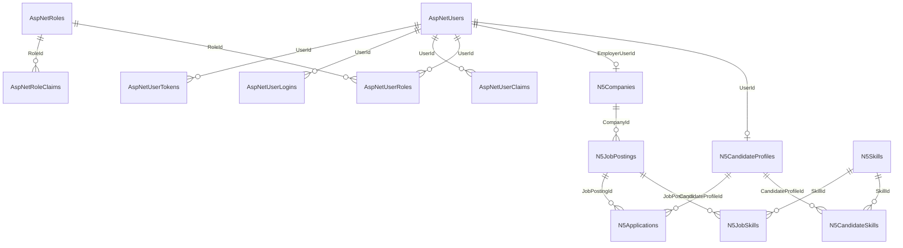

# Từ điển dữ liệu RecruitHub N5

Đối chiếu từ model EF Core và cấu trúc thực tế trong SQL Server ngày 28/10/2026. Migration hiện hành: `20261027181133_N5InitialCreate`. Tên lớp có tiền tố N5; `N5AppUser` ánh xạ vào bảng chuẩn `AspNetUsers`.

## Quy ước chung

PK là khóa chính, FK là khóa ngoại, UQ là ràng buộc duy nhất. Cột Null ghi Có nếu SQL cho phép NULL. `int IDENTITY(1,1)` tự sinh ID. Chuỗi Unicode dùng nvarchar. Thời gian dùng datetimeoffset(7) với offset +00:00; EF chuyển giá trị đầu vào sang UTC. Các giá trị mặc định nêu dưới đây là giá trị khởi tạo trong C#, không phải DEFAULT constraint của SQL.

Giới hạn `HasMaxLength(10000)` của mô tả tin được SQL Server ánh xạ thành nvarchar(max); tầng nhập liệu cần giới hạn 10.000 ký tự. Các chuỗi không null vẫn có thể rỗng khi lưu nháp/hồ sơ chưa hoàn tất; Service chịu trách nhiệm kiểm tra điều kiện trước đăng tin/nộp đơn.

## AspNetUsers và N5AppUser

| Cột | Kiểu SQL | Null | Vai trò |
| --- | --- | --- | --- |
| Id | nvarchar(450) | Không | PK Identity, ID string |
| FullName | nvarchar(100) | Không | Họ tên dùng chung tài khoản và hồ sơ |
| UserName | nvarchar(256) | Có | Tên đăng nhập |
| NormalizedUserName | nvarchar(256) | Có | UQ có lọc IS NOT NULL |
| Email | nvarchar(256) | Có | Email tài khoản |
| NormalizedEmail | nvarchar(256) | Có | Index tra cứu email; không phải unique index |
| EmailConfirmed | bit | Không | Xác nhận email |
| PasswordHash | nvarchar(max) | Có | Hash do Identity quản lý |
| SecurityStamp | nvarchar(max) | Có | Dấu thay đổi thông tin bảo mật |
| ConcurrencyStamp | nvarchar(max) | Có | Kiểm soát cập nhật đồng thời của Identity |
| PhoneNumber | nvarchar(max) | Có | Điện thoại tài khoản Identity; độc lập Phone của hồ sơ |
| PhoneNumberConfirmed | bit | Không | Xác nhận điện thoại |
| TwoFactorEnabled | bit | Không | Trạng thái xác thực hai bước của Identity |
| LockoutEnd | datetimeoffset(7) | Có | Thời điểm hết khóa tài khoản do Identity quản lý |
| LockoutEnabled | bit | Không | Cho phép khóa |
| AccessFailedCount | int | Không | Số lần đăng nhập thất bại |

Điều kiện email duy nhất do `UserManager` với `RequireUniqueEmail=true` xử lý; UserName dùng email và có unique index chuẩn Identity. Không tự quản lý mật khẩu hoặc role bằng cột trong N5AppUser. Hạn chế offset UTC ở các bảng nghiệp vụ không áp lên cột do Identity quản lý.

## N5CandidateProfiles

| Cột | Kiểu SQL | Null | Vai trò |
| --- | --- | --- | --- |
| Id | int IDENTITY(1,1) | Không | PK |
| UserId | nvarchar(450) | Không | FK AspNetUsers.Id; UQ |
| Phone | nvarchar(30) | Có | Số điện thoại hồ sơ |
| Location | nvarchar(200) | Có | Nơi ở/địa điểm mong muốn |
| Introduction | nvarchar(2000) | Không | Giới thiệu; mặc định chuỗi rỗng |
| Education | nvarchar(4000) | Có | Học vấn dạng văn bản |
| Experience | nvarchar(4000) | Có | Kinh nghiệm dạng văn bản |

## N5Companies

| Cột | Kiểu SQL | Null | Vai trò |
| --- | --- | --- | --- |
| Id | int IDENTITY(1,1) | Không | PK |
| EmployerUserId | nvarchar(450) | Không | FK AspNetUsers.Id; UQ |
| Name | nvarchar(200) | Không | Tên công ty |
| Description | nvarchar(4000) | Có | Giới thiệu công ty |
| Address | nvarchar(500) | Có | Địa chỉ |
| Website | nvarchar(2048) | Có | Website |

## N5Skills

| Cột | Kiểu SQL | Null | Vai trò |
| --- | --- | --- | --- |
| Id | int IDENTITY(1,1) | Không | PK |
| Name | nvarchar(100) | Không | Tên hiển thị, không chỉ chứa khoảng trắng |
| NormalizedName | nvarchar(100) | Không | UQ; tên chuẩn hóa, không rỗng |
| IsActive | bit | Không | Mặc định C# true; false là ngừng chọn mới |

DbContext chuẩn hóa khoảng trắng và chuyển hoa invariant, giữ ký hiệu kỹ thuật. C, C# và C++ là ba kỹ năng riêng. Ngừng dùng kỹ năng không xóa bảng nối đã có; các liên kết đó vẫn được tính điểm theo ID.

## N5CandidateSkills

| Cột | Kiểu SQL | Null | Vai trò |
| --- | --- | --- | --- |
| CandidateProfileId | int | Không | PK ghép; FK N5CandidateProfiles.Id |
| SkillId | int | Không | PK ghép; FK N5Skills.Id |

PK `(CandidateProfileId, SkillId)` chặn kỹ năng lặp trong một hồ sơ. Có index riêng SkillId.

## N5JobPostings

| Cột | Kiểu SQL | Null | Vai trò |
| --- | --- | --- | --- |
| Id | int IDENTITY(1,1) | Không | PK |
| CompanyId | int | Không | FK N5Companies.Id |
| Title | nvarchar(200) | Không | Tiêu đề |
| Description | nvarchar(max) | Không | Nội dung; giới hạn nhập liệu 10.000 ký tự |
| Location | nvarchar(200) | Có | Địa điểm tuyển |
| SalaryText | nvarchar(200) | Có | Lương dạng văn bản |
| PublishedAt | datetimeoffset(7) | Có | UTC; bắt buộc nếu Published hoặc Closed |
| Deadline | datetimeoffset(7) | Không | Hạn nhận hồ sơ UTC |
| Status | int | Không | 0 Draft, 1 Published, 2 Closed; mặc định C# Draft |

Index `(Status, Deadline, PublishedAt)` phục vụ danh sách còn tuyển; `(CompanyId, Status)` phục vụ quản lý và tổng quan. Tin hết hạn vẫn giữ Status, được lọc theo Deadline. Ngày nhập hạn cần chuyển từ cuối ngày theo giờ Việt Nam sang UTC ở tầng nghiệp vụ, không dùng ngày UTC trực tiếp làm ngày hiển thị.

## N5JobSkills

| Cột | Kiểu SQL | Null | Vai trò |
| --- | --- | --- | --- |
| JobPostingId | int | Không | PK ghép; FK N5JobPostings.Id |
| SkillId | int | Không | PK ghép; FK N5Skills.Id |

PK `(JobPostingId, SkillId)` chặn kỹ năng lặp trong một tin. Có index riêng SkillId. Service giữ nguyên tập kỹ năng khi tin đã có đơn.

## N5Applications

| Cột | Kiểu SQL | Null | Vai trò |
| --- | --- | --- | --- |
| Id | int IDENTITY(1,1) | Không | PK |
| JobPostingId | int | Không | FK N5JobPostings.Id |
| CandidateProfileId | int | Không | FK N5CandidateProfiles.Id |
| CoverLetter | nvarchar(2000) | Có | Thư giới thiệu |
| AppliedAt | datetimeoffset(7) | Không | UTC; mặc định C# UtcNow khi tạo entity |
| Status | int | Không | 0 Submitted, 1 Reviewing, 2 Accepted, 3 Rejected; mặc định Submitted |

UQ `(JobPostingId, CandidateProfileId)` chặn nộp trùng kể cả hai yêu cầu đồng thời. Index `(JobPostingId, Status)` phục vụ danh sách đơn theo tin/trạng thái; index CandidateProfileId phục vụ đơn của ứng viên. Đơn liên kết đến hồ sơ hiện tại, không có snapshot. Đóng tin/hết hạn không thay đổi hoặc xóa đơn.

## Các bảng Identity còn lại

| Bảng | Khóa chính | Quan hệ và ý nghĩa |
| --- | --- | --- |
| AspNetRoles | Id: nvarchar(450) | Name/NormalizedName: nvarchar(256); UQ NormalizedName có lọc; ConcurrencyStamp: nvarchar(max) |
| AspNetUserRoles | (UserId, RoleId): nvarchar(450) | Hai FK tới Users/Roles; gán Candidate, Employer, Admin |
| AspNetUserClaims | Id: int identity | UserId: nvarchar(450) FK; ClaimType/ClaimValue: nvarchar(max), nullable |
| AspNetRoleClaims | Id: int identity | RoleId: nvarchar(450) FK; ClaimType/ClaimValue: nvarchar(max), nullable |
| AspNetUserLogins | (LoginProvider, ProviderKey): nvarchar(450) | UserId: nvarchar(450) FK; ProviderDisplayName: nvarchar(max), nullable |
| AspNetUserTokens | (UserId, LoginProvider, Name): nvarchar(450) | FK UserId; Value: nvarchar(max), nullable |

Các bảng Identity giữ cấu hình chuẩn và FK cascade nội bộ của Identity. Mốc seed `N5RecruitHub:DemoSeed=v1` là claim kỹ thuật gắn admin demo, không cấp thêm quyền. `__EFMigrationsHistory` lưu MigrationId/phiên bản EF, không thuộc mô hình nghiệp vụ.

## Quan hệ và bảo toàn dữ liệu

| Quan hệ | Bội số | Ràng buộc |
| --- | --- | --- |
| AspNetUsers → N5CandidateProfiles | 1 → 0..1 | UserId UQ; hồ sơ luôn có tài khoản |
| AspNetUsers → N5Companies | 1 → 0..1 | EmployerUserId UQ; công ty luôn có tài khoản quản lý |
| N5Companies → N5JobPostings | 1 → 0..n | Tin luôn thuộc một công ty |
| N5CandidateProfiles → N5CandidateSkills ← N5Skills | n ↔ n | Bảng nối có PK ghép |
| N5JobPostings → N5JobSkills ← N5Skills | n ↔ n | Bảng nối có PK ghép |
| N5CandidateProfiles → N5Applications ← N5JobPostings | n ↔ n qua đơn | UQ cặp hồ sơ–tin |

Tất cả chín FK nghiệp vụ dùng NO ACTION, không cascade delete. SQL chặn xóa bản ghi cha đang được tham chiếu. Việc chỉ Candidate có hồ sơ, chỉ Employer quản lý công ty và mỗi người dùng có đúng loại dữ liệu theo role do tầng nghiệp vụ bảo đảm; FK không tự xác định role. Các CHECK chỉ kiểm tra miền giá trị trạng thái, PublishedAt, tên kỹ năng và offset thời gian; trình tự chuyển trạng thái do Service xử lý.

## Nguồn ERD cho chat Sơ đồ

Đây là nguồn mô tả cấu trúc thực tế để chat Sơ đồ/Word sử dụng; không chỉnh sửa các sơ đồ hoặc báo cáo do chat khác sở hữu.
